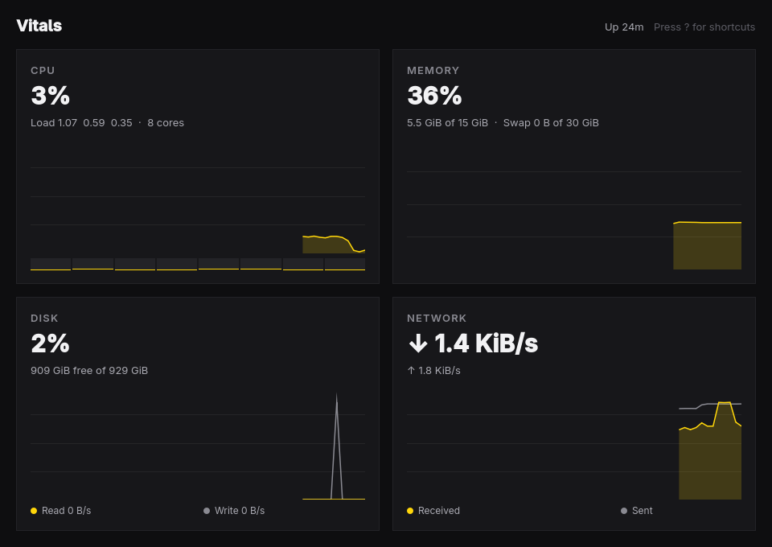

# Vitals



Live CPU, memory, disk, and network usage at a glance, for
[Omarchy](https://omarchy.org). One window, four graphs covering the last
minute, following the Omarchy theme accent, window rounding, and language
live.

- **CPU**: total usage, load averages, and a bar per core.
- **Memory**: used of total (what the kernel can't hand back right away), plus swap.
- **Disk**: how full `/` is, and read/write throughput across physical disks.
- **Network**: received and sent across every interface but loopback.

Everything is read straight from `/proc`, `/sys/block`, and `statvfs`, once a
second. If one of them can't be read, the window says so.

## Keyboard

| Key   | Action                 |
|-------|------------------------|
| Space | Pause or resume        |
| ?     | Show or hide shortcuts |
| Esc   | Close the shortcuts    |
| Q     | Quit                   |

## Build

```sh
bin/build      # build/vitals
bin/test       # Qt Test, offscreen
bin/install    # makepkg -fsi, adds Vitals to the app launcher
```

Needs `qmake6`, `make`, a C++17 compiler, and Qt 6 base and declarative,
all part of Omarchy.

## License

MIT. See [LICENSE](LICENSE).
